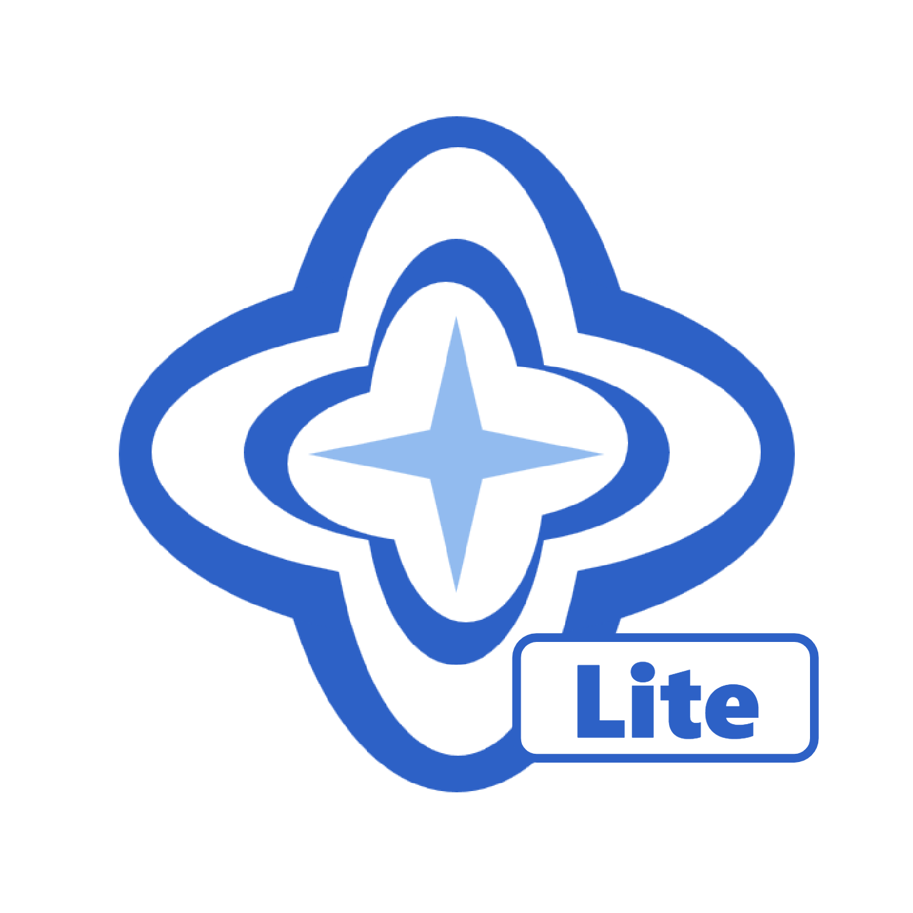

# CoomiLite

<table align="center">
  <tr>
    <td align="center" width="20%">
      
      <br />
      <sub><strong>TensorHub</strong><br />组织 LOGO</sub>
    </td>
    <td align="center" width="20%">
      
      <br />
      <sub><strong>Coomi</strong><br />Agent 吉祥物</sub>
    </td>
    <td align="center" width="20%">
      
      <br />
      <sub><strong>CoomiLite</strong><br />项目 LOGO</sub>
    </td>
    <td align="center" width="20%">
      
      <br />
      <sub><strong>QQ 交流群</strong><br />扫码加入</sub>
    </td>
    <td align="center" width="20%">
      
      <br />
      <sub><strong>QQ 频道</strong><br />板块讨论</sub>
    </td>
  </tr>
</table>

<p align="center">
  
  
  
  
  
  
</p>

CoomiLite 是从 `v1.3.2` 重新出发的精简版：保留“一个会话 + 一个 Agent + 一套工具”的顺手体验，不内置 Proot/Ubuntu，不引入工作室、工作台、工作流、数字生命体、提示词库等独立产品面。需要复用能力时，统一映射到已有名词：会话、任务、工具、技能、MCP、模型服务、子代理、记忆、身份、运行环境。

> 当前状态：开发中。基线源码来自 `v1.3.2` tag，新版能力按 `docs/lite/backports.md` 逐项回植。

## 已有能力

- **本地 Agent 引擎**：Rust 引擎 + 本地会话存储，只有模型请求离开设备。
- **多 Provider**：OpenAI 兼容、OpenAI Responses、Anthropic、Gemini；模型能力可配置。
- **真实工具执行**：shell、持久进程、文件读写/编辑/补丁/搜索、图片、网页搜索与抓取、文件导入导出。
- **会话**：历史、置顶、标题、草稿、断线重连、后台继续、最多 5 个会话并行。
- **SKILL / MCP**：内置目录 + 自定义配置；按需读取 Skill，MCP 工具动态并入。
- **记忆**：global / project / local 三层，手动管理。
- **上下文压缩**：自动阈值 + 手动 `/compact`。
- **子代理模型**：在设置里给审查、编码等任务配置不同 Provider / 模型、工具集和附加指令；`spawn_agent(task, agent_id?)` 指定，不配置时沿用主模型。
- **运行环境**：Termux 兼容环境；不内置 Proot，不再打包 Ubuntu/Debian rootfs。
- **数据与更新**：文件管理、主题、备份恢复、覆盖安装升级。

## 开发

```bash
# Rust 引擎
cd apps/coomi-rs
cargo check --workspace
cargo test --workspace

# Web 前端
cd apps/web
npm install
npm run build

# Android APK（需要 Android SDK + NDK 27）
./gradlew :app:assembleDebug
```

复杂度预算：

```bash
python tools/lite_budget.py
```

目标：Rust ≤ 20k 行、Web ≤ 8k 行、页面 ≤ 14、内置工具 ≤ 24、API 路由 ≤ 70、执行路径 2 条、新增产品名词 0 个。硬上限与当前值见脚本输出。

## 项目结构

```text
Coomi-Android-Lite/
├─ apps/coomi-app/        # Android 壳（Termux 环境、WebView、更新/备份）
├─ apps/coomi-rs/         # Rust 引擎
│  ├─ engine/             # 会话、上下文、Agent 循环
│  ├─ services/           # Provider、MCP、记忆、子代理 Profile
│  ├─ tools/              # 内置工具、进程、子代理调度
│  ├─ security/           # 路径与命令策略、Hooks
│  ├─ catalogs/           # 内置 Skill/MCP 目录
│  └─ ui/                 # coomi serve + 无头 exec CLI（无交互 TUI）
├─ apps/web/              # Vue 3 + Pinia 前端（打包为 web.zip）
├─ assets/                # LOGO、吉祥物、社群二维码
├─ docs/lite/             # Lite 方案、开发说明、回植清单
├─ deploy/                # 发行部署与更新源
└─ tools/                 # 开发辅助脚本与预算检查
```

## 文档

- [Lite 完整方案](docs/lite/plan.md)
- [开发说明](docs/lite/README.md)
- [新版能力回植清单](docs/lite/backports.md)
- [更新源](https://updates.septemc.com/coomi/android/latest.json)

## 许可证

本项目采用 Apache License 2.0 许可证。详细条款请阅读 [LICENSE](LICENSE)。

## 作者与版权

Copyright 2026 Septemc and TensorHub.
